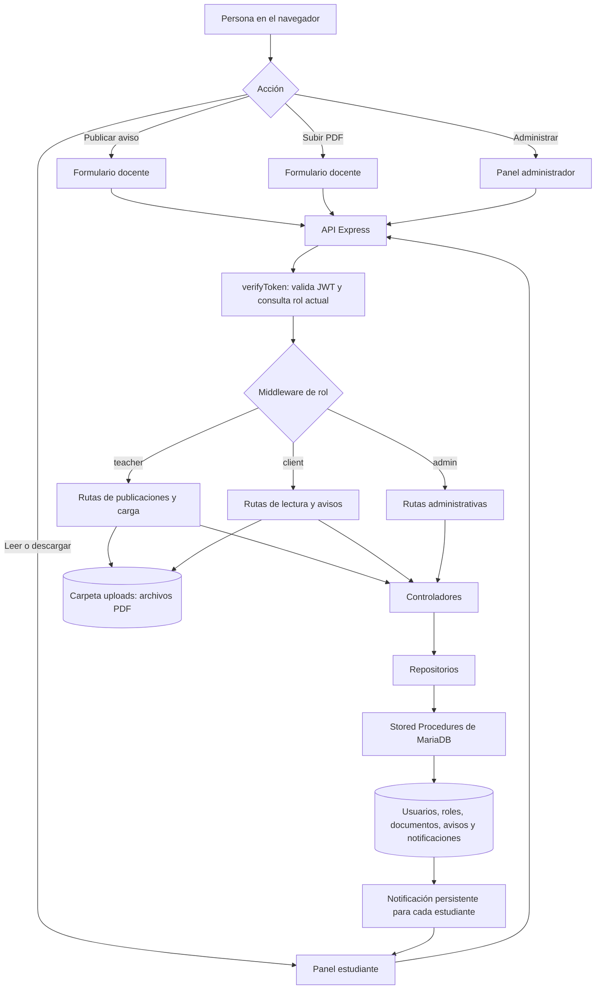

# ⧉ Bibliotech

**Bibliotech** es una plataforma web para la gestión documental de libros y archivos en formato PDF (.pdf). Diseñada bajo una arquitectura en **N capas**, aplicando el **patrón Repository**, uso estricto de **Stored Procedures** en base de datos y un frontend seguro con manipulación nativa del DOM (**Zero innerHTML**).

Este proyecto surge de la evolución y transformación del sistema *Sample Vault*, adaptando la gestión multimedia hacia un repositorio documental de lectura y descarga digital con un alto enfoque en estándares profesionales de Ingeniería de Software.

Proyecto Sample Vault Original: https://github.com/gabrielinuz/sample-vault  
Revisión V1.0 Sergio Puchatt: https://github.com/Sdpuchatt  
Revisión V2.0 GNGF: https://github.com/tecnobfi/bibliotech  

---

## ⧉ Hitos de Ingeniería y Arquitectura

1. **Arquitectura en N Capas (Separación Estricta de Responsabilidades)**:
   - **Base de Datos**: Stored Procedures para transacciones encapsuladas y aplicación del Principio de Menor Privilegio (PoLP).
   - **Repositorios (`Repository Pattern`)**: Abstracción total del acceso a datos.
   - **Controladores**: Gestión exclusiva de la lógica de negocio semántica.
   - **Middlewares**: Escudos preventivos para validación sintáctica y autorización.
   - **Rutas (`Router`)**: Enrutamiento declarativo y modular para la API.
2. **Motor de Validación Custom y Patrones de Diseño**:
   - Implementación de la clase `Validator` utilizando **Fluent Interface**, **Strategy** (Principio Abierto/Cerrado para reglas) y **Visitor**.
   - `validation_middleware.js`: Aplica las reglas del validador deteniendo peticiones malformadas antes de que alcancen los controladores (Principio *Fail-Fast*).
3. **Internacionalización y Localización (i18n)**:
   - Implementación del patrón **Singleton** para cargar diccionarios estáticos en memoria, centralizando y traduciendo todos los mensajes del sistema y excepciones sin *hardcodear* strings en la lógica.
4. **Filtro de Errores Global**:
   - `global_error_middleware.js`: Red de contención final que atrapa excepciones del sistema, fallos de Multer o errores de MySQL (`ER_DUP_ENTRY`, `ECONNREFUSED`), traduciéndolos a un formato JSON estandarizado sin exponer el *stack trace* en producción.
5. **Frontend Seguro (Zero-XSS)**:
   - Renderización dinámica de tablas y modales utilizando estrictamente métodos nativos del DOM (`createElement`, `textContent`, `replaceChildren`), erradicando por completo el uso de la propiedad insegura `innerHTML`.

---

## ⧉ Tecnologías Utilizadas

### Avisos y material docente
- Las cuentas **docente** pueden publicar noticias con un PDF adjunto opcional.
- Cada publicación genera una notificación persistente para las cuentas de estudiante existentes.
- El panel de estudiante actualiza los avisos automáticamente cada 30 segundos y permite marcarlos como leídos.
- El docente puede subir documentos a la biblioteca; cada carga avisa a los estudiantes.
- Cada perfil docente registra su materia y el estudiante puede filtrar los materiales por asignatura.
- El estudiante consulta, lee y descarga documentos. La API bloquea sus operaciones de carga y borrado.
- El administrador ve los documentos y adjuntos, crea y elimina cuentas y asigna roles. El sistema conserva al menos un administrador.

### Backend
- **Node.js & Express**: Servidor HTTP modular y enrutamiento REST.
- **MySQL / MariaDB (`mysql2`)**: Base de datos relacional y ejecución de Prepared Statements.
- **Multer**: Procesamiento seguro de cargas `multipart/form-data` para archivos PDF.
- **JSON Web Tokens (JWT)**: Autenticación *stateless* basada en tokens Bearer.
- **Bcrypt**: Hashing seguro de contraseñas con factor de costo.
- **Dotenv**: Gestión de variables de entorno para protección de secretos.

### Frontend
- **Vanilla JavaScript**: Lógica frontend asíncrona (Fetch API) sin frameworks pesados.
- **W3.CSS**: Framework CSS ligero para diseño responsive y componentes UI.
- **CSS Custom Properties**: Paleta de colores unificada (Single Source of Truth).

---

## ⧉ Estructura del Proyecto

```text
bibliotech/
├── backend/
│   ├── config/
│   │   ├── db.js                        # Pool de conexiones a MySQL
│   │   ├── init.sql                     # Script DDL: tablas, usuario y Stored Procedures
│   │   ├── delete.sql                   # Script de limpieza idempotente
│   │   └── multer_config.js             # Configuración y filtro estricto de PDFs
│   ├── controllers/
│   │   ├── admin_controller.js          # Lógica semántica de administración
│   │   ├── auth_controller.js           # Registro e inicio de sesión
│   │   └── book_controller.js           # Carga, consulta y borrado de documentos
│   ├── middleware/
│   │   ├── auth_middleware.js           # Verificación de JWT y roles
│   │   ├── global_error_middleware.js   # Red de contención y traducción de contingencias
│   │   └── validation_middleware.js     # Escudo de validación sintáctica (Validator)
│   ├── repositories/
│   │   ├── book_repository.js           # Acceso a datos de libros (Capa Data Access)
│   │   └── user_repository.js           # Acceso a identidades
│   ├── routes/
│   │   ├── admin_routes.js              # Endpoints protegidos para admins
│   │   ├── auth_routes.js               # Endpoints públicos de identidad
│   │   ├── book_routes.js               # Endpoints de la biblioteca privada
│   │   ├── tests_routes.js              # Ruta condicional para suite de pruebas
│   │   └── view_routes.js               # Enrutador de pantallas HTML
│   ├── uploads/                         # Directorio físico de almacenamiento PDF
│   ├── utils/
│   │   ├── db_utils/
│   │   │   ├── db_check.js              # Script CLI de diagnóstico de conexión
│   │   │   └── db_setup.js              # Inicialización automatizada (Bootstrap DB)
│   │   ├── file_helper/
│   │   │   └── file_helper.js           # Limpieza síncrona de archivos huérfanos
│   │   ├── i18n/
│   │   │   ├── locales/                 # Diccionarios JSON (es.json, en.json)
│   │   │   ├── i18n.js                  # Motor Singleton de traducciones
│   │   │   └── README.md                # Documentación del módulo
│   │   └── validator/
│   │       ├── rules/                   # Estrategias OCP (min_length, required, etc.)
│   │       ├── validator.js             # Motor Fluent Interface
│   │       └── README.md                # Documentación del módulo
│   ├── .env                             # Variables de entorno locales
│   ├── .env.example                     # Plantilla de variables de entorno
│   ├── package.json                     # Dependencias y scripts de Node
│   └── server.js                        # Punto de entrada y definición del Pipeline
├── frontend/
│   ├── css/
│   │   ├── style.css                    # Estilos personalizados (Variables CSS)
│   │   └── w3.css                       # Framework estructural
│   ├── html/
│   │   ├── admin_dashboard.html         # Panel de auditoría de usuarios
│   │   ├── client_dashboard.html        # Interfaz de lectura y gestión PDF
│   │   ├── login.html                   # Pantalla de inicio de sesión
│   │   ├── register.html                # Pantalla de creación de cuenta
│   │   └── tests.html                   # Interfaz del laboratorio de pruebas DOM
│   ├── img/                             # Favicon e iconografía
│   └── js/
│       ├── components/
│       │   └── ui_handlers.js           # Constructores de modales dinámicos (Zero-innerHTML)
│       ├── front_controllers/
│       │   ├── admin_front_controller.js
│       │   ├── auth_front_controller.js
│       │   └── books_front_controller.js
│       ├── services/
│       │   └── api_service.js           # Cliente Fetch interceptor (Inyección JWT)
│       ├── tests/
│       │   ├── admin_tests.js           # Tests unitarios de rol administrador
│       │   ├── auth_tests.js            # Tests de escudos de identidad (400, 401, 409)
│       │   ├── book_tests.js            # Simulación Blob de subida documental
│       │   └── test_utils.js            # Framework de testing DOM
│       └── utils/
│           └── auth_helper.js           # Gestión del ciclo de vida en localStorage
├── .gitignore
└── README.md
```

---

## ⚙️ Instalación y Puesta en Marcha

### 1. Prerrequisitos
- **Node.js** (v18 o superior recomendado)
- **MySQL** o **MariaDB** (por ejemplo mediante XAMPP, Laragon o servicio local)

### 2. Configurar Variables de Entorno
En la carpeta `backend/`, copia `.env.example` a `.env` y ajusta los datos de MariaDB:

```env
PORT=3000
DB_HOST=localhost
DB_PORT=3306
DB_USER=bibliotech
DB_PASS=bibliotech
DB_NAME=bibliotech
DB_ROOT_HOST=localhost
DB_ROOT_PORT=3306
DB_ROOT_USER=root
DB_ROOT_PASS=
JWT_SECRET=una_clave_aleatoria_larga
NODE_ENV=production
```

### 3. Instalar Dependencias
Desde la terminal, accede a la carpeta `backend`:

```bash
cd backend
npm install
```

### 4. Inicializar la Base de Datos
Con MariaDB iniciado, para crear o actualizar el esquema `bibliotech`, el usuario de aplicación, las tablas y los Stored Procedures, ejecuta:

```bash
npm run db:setup
```

Este comando conserva las tablas y los datos existentes. Si el usuario root de MariaDB tiene contraseña, configúrala con `DB_ROOT_PASS` en `.env`.

*(Opcional: Si cuentas con una contraseña para el usuario root de MySQL, puedes importar manualmente el archivo `backend/config/init.sql` desde **phpMyAdmin**, **MySQL Workbench** o la consola de MySQL).*

### 5. Iniciar la Aplicación

```bash
npm start
```

El servidor estará listo y escuchando en:
👉 **`http://localhost:3000`**

---

## ⧉ Guía de Uso

Abre tu navegador e ingresa a `http://localhost:3000`.

### Usuarios de Prueba Preconfigurados:

| Rol | Usuario | Contraseña | Permisos y Funcionalidad |
| :--- | :--- | :--- | :--- |
| **Estudiante** | `pepe` | `12345` | Avisos docentes, material adjunto y biblioteca personal. |
| **Administrador** | `admin` | `12345` | Gestión de cuentas y usuarios. |

El administrador puede crear cuentas docentes y estudiantes desde el panel. Para publicar, el docente inicia sesión y usa `/teacher_dashboard`.

*(También es posible crear nuevos usuarios desde el enlace **Regístrate** en la pantalla de inicio).*

---

## ⧉ Laboratorio de Pruebas API

El proyecto incluye un entorno integrado para validar los endpoints y filtros de error:

1. En el archivo `backend/.env`, cambia la variable `NODE_ENV`:
   ```env
   NODE_ENV=testing
   ```
2. Reinicia el servidor (`npm start`).
3. Accede a `http://localhost:3000`. Verás la consola interactiva con botones para ejecutar tests automatizados de:
   - Login correcto e incorrecto.
   - Control de contraseñas cortas (< 6 caracteres) con respuesta HTTP 400.
   - Prevención de usuarios duplicados con respuesta HTTP 409 (`ER_DUP_ENTRY`).
   - Carga y listado de documentos PDF con autenticación Bearer.
   - Listado administrativo de cuentas.

---

## 📚 Guía rápida para entender y exponer Bibliotech

### ¿Qué resuelve el sistema?

Bibliotech organiza documentos PDF y avisos de una institución. Cada persona entra con un rol:

| Rol | Puede hacer |
|---|---|
| **Estudiante (`client`)** | Ver avisos, marcar avisos como leídos, filtrar documentos por materia, leerlos y descargarlos. |
| **Docente (`teacher`)** | Publicar avisos, adjuntar PDF y subir documentos a la biblioteca. |
| **Administrador (`admin`)** | Ver la gestión global, crear usuarios, asignar roles y materias, revisar o eliminar documentos y cuentas. |

### Diagrama del flujo principal



### Cómo funciona una publicación docente

1. El formulario del docente (`frontend/html/teacher_dashboard.html`) arma los datos y, si corresponde, un archivo PDF.
2. `teacher_front_controller.js` envía la petición a la API como `multipart/form-data`.
3. La ruta (`announcement_routes.js` o `book_routes.js`) exige una sesión válida y el rol `teacher`.
4. Multer valida y guarda el PDF en `backend/uploads/`. El middleware de validación comprueba los campos obligatorios y el tipo/tamaño de archivo.
5. El controlador coordina la operación y el repositorio llama a un Stored Procedure de MariaDB para guardar los metadatos.
6. Al crear un aviso, `sp_create_announcement` también crea una fila de notificación para cada estudiante existente. Al subir un libro, el controlador genera además un aviso automático.
7. El panel estudiante pide los avisos a la API y actualiza la lista cada 30 segundos. Las notificaciones quedan guardadas y se pueden marcar como leídas.

**Nota técnica:** la actualización de avisos es por consulta periódica (polling), no mediante WebSocket o notificaciones push del navegador. Por eso el aviso aparece al actualizar la consulta, como máximo en el siguiente ciclo de 30 segundos.

### Capas y archivos importantes

| Capa | Responsabilidad | Ejemplos |
|---|---|---|
| Interfaz | Formularios, paneles, filtros y acciones visibles. | `frontend/html/teacher_dashboard.html`, `frontend/js/front_controllers/teacher_front_controller.js` |
| Servicio API del frontend | Centraliza `fetch`, el token Bearer y las respuestas. | `frontend/js/services/api_service.js` |
| Rutas | Declara URL, método HTTP y orden de middlewares. | `backend/routes/book_routes.js`, `backend/routes/announcement_routes.js`, `backend/routes/admin_routes.js` |
| Middlewares | Comprueba identidad, rol y datos antes de ejecutar la lógica. | `backend/middleware/auth_middleware.js`, `backend/middleware/validation_middleware.js` |
| Controladores | Coordina reglas de negocio y respuestas HTTP. | `backend/controllers/book_controller.js`, `backend/controllers/announcement_controller.js`, `backend/controllers/admin_controller.js` |
| Repositorios | Aísla las consultas y llamadas a base de datos. | `backend/repositories/book_repository.js`, `backend/repositories/announcement_repository.js`, `backend/repositories/user_repository.js` |
| Base de datos | Guarda relaciones y ejecuta operaciones SQL encapsuladas. | `backend/config/init.sql` |

### Patrones de diseño que podés explicar

- **Arquitectura en capas / separación de responsabilidades:** la pantalla no ejecuta SQL; cada parte del programa tiene una tarea concreta. Esto facilita mantener y cambiar el sistema.
- **Repository:** los controladores usan repositorios en vez de conocer detalles de SQL. Por ejemplo, `AnnouncementController` llama a `announcementRepository.create(...)`.
- **Middleware Pipeline (cadena de middlewares):** una petición pasa por autenticación, autorización y validación antes de llegar al controlador. Si falla una etapa, se detiene con un error HTTP.
- **Stored Procedures:** las operaciones principales se encapsulan en MariaDB; por ejemplo, `sp_create_announcement` crea el aviso y sus notificaciones en una transacción.
- **MVC como referencia:** las vistas HTML y sus controladores JavaScript conforman la interfaz; Express enruta las peticiones y los controladores backend coordinan la lógica. No es MVC puro porque el frontend y backend están separados y el modelo de datos se accede mediante repositorios.
- **Principio de menor privilegio:** la aplicación usa un usuario de base de datos separado de `root`, con permisos limitados configurados por el script de inicialización.

### Puntos para exponer al profesor

Podés presentar el proyecto con estas ideas:

1. **Problema:** centralizar documentos y comunicados, organizados por materia y con permisos según el rol.
2. **Roles:** explicar qué acciones habilita cada rol y que el servidor vuelve a comprobar los permisos; ocultar un botón en la interfaz no sería suficiente seguridad.
3. **Recorrido de una petición:** formulario → endpoint → autenticación/rol → validación → controlador → repositorio → Stored Procedure → respuesta.
4. **Persistencia de avisos:** cada aviso genera registros por estudiante en `notifications`; el estado leído se almacena en `read_at`.
5. **Archivos y metadatos:** el PDF se almacena en disco y MariaDB guarda su ruta y sus datos descriptivos. Esto permite listar y filtrar sin cargar el archivo entero en cada consulta.
6. **Organización:** docente y materia se asocian mediante `teacher_profiles`; la biblioteca muestra la materia y el estudiante puede filtrar por ella.
7. **Seguridad del frontend:** el contenido dinámico se crea con `createElement` y `textContent`, evitando insertar avisos como HTML ejecutable.

Una forma breve de cerrar la exposición:

> “La aplicación separa interfaz, reglas de negocio y persistencia. Los roles se verifican en el backend; los documentos se guardan como archivos y sus metadatos en MariaDB; los avisos generan notificaciones persistentes para que cada estudiante pueda consultarlas y marcarlas como leídas.”
